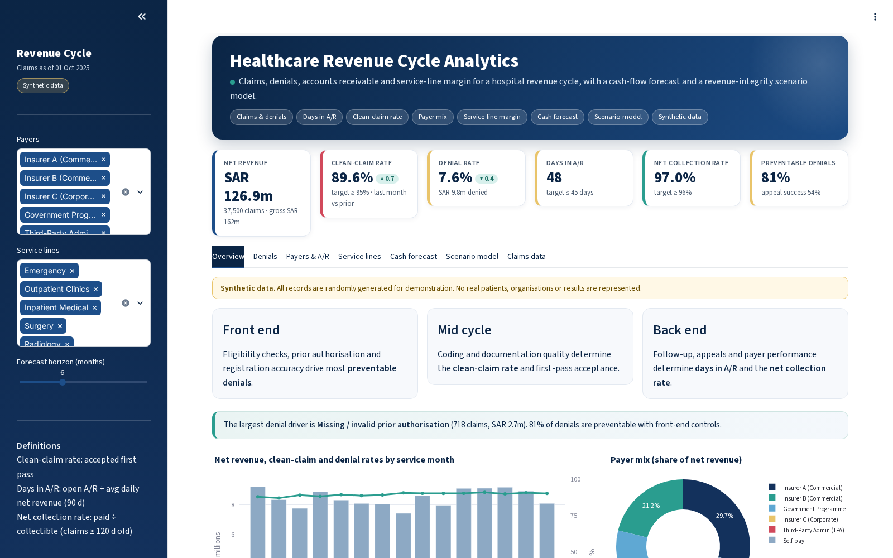
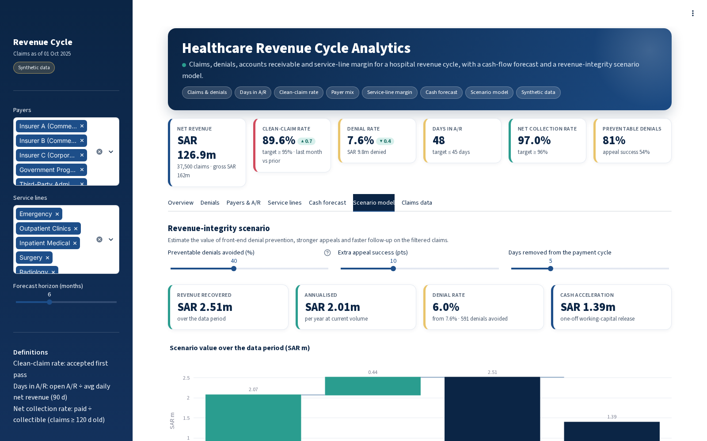
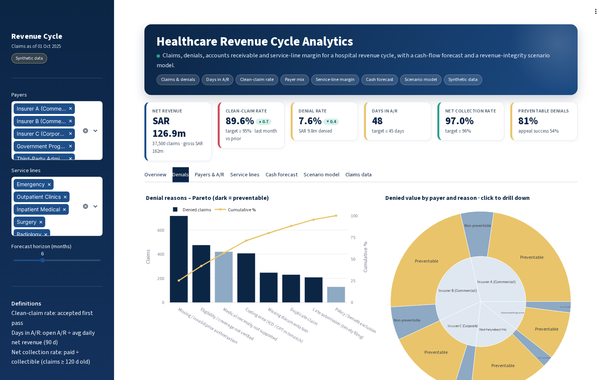
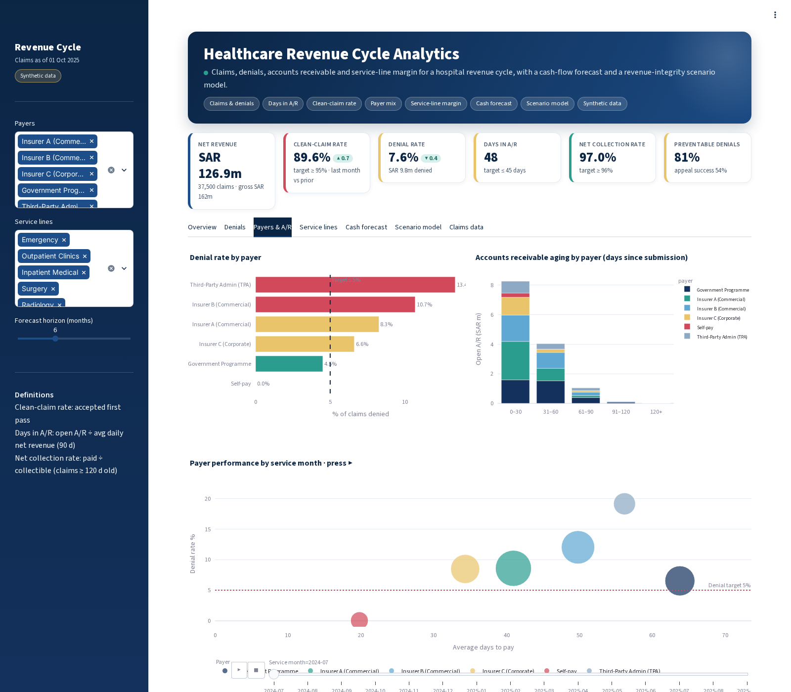
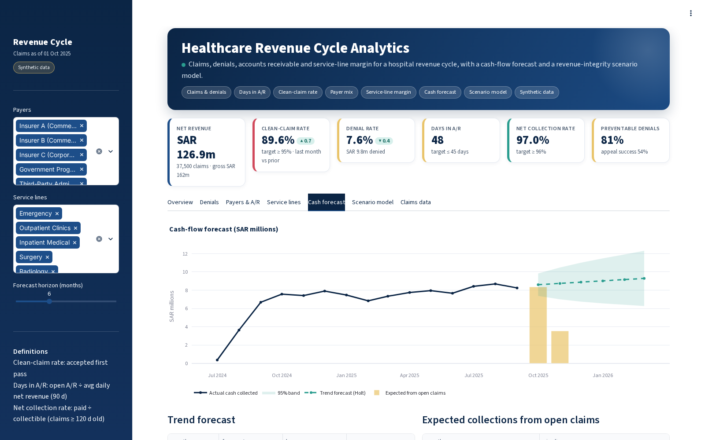
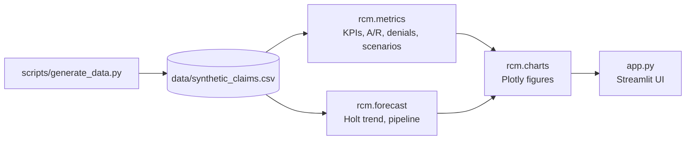

<div align="center">

# Healthcare Revenue Cycle Analytics

**Claims, denials, accounts receivable and service-line margin for a hospital revenue cycle, with a cash forecast and a revenue-integrity scenario model.**

    [](https://github.com/MOHAMMEDYOUSEFALAHMADI/healthcare-revenue-cycle-analytics/actions/workflows/tests.yml)  

</div>

> **Synthetic data only.** Every record in this repository is generated by a script with a fixed random seed.
> No real patients, staff, organisations or payers are represented, and the figures are not real-world results.

## Why this project

Most revenue a hospital loses is not lost on price; it is lost to denied claims that were preventable,
appeals that were never filed, and slow follow-up that ties up cash in receivables. Finance and operations
teams need to see where the leakage is (which payer, which reason, which service line) and what fixing it
would be worth.

This app covers the revenue cycle end to end on a synthetic claims file: clean-claim and denial rates,
denial reasons split into preventable and non-preventable, payer performance, A/R ageing, days in A/R,
net collection rate, service-line contribution margin and a short-term cash forecast. A scenario model puts
a SAR value on front-end denial prevention, stronger appeals and faster follow-up.

## Features

- **Headline KPIs**: net revenue, clean-claim rate, denial rate, days in A/R, net collection rate and preventable-denial share, with month-on-month change
- **Denials**: Pareto by reason and a click-to-drill sunburst from payer to preventable / non-preventable to reason
- **Payers and A/R**: denial rate by payer, A/R ageing buckets, and an animated view of each payer's denial rate vs days to pay over time
- **Service lines**: gross charges, realised net revenue, direct cost and contribution margin
- **Cash forecast**: Holt linear trend forecast with an interval, plus expected collections from open claims based on each payer's payment pattern
- **Scenario model**: revenue recovered from preventing denials and better appeals, the resulting denial rate, and one-off cash released by shortening the payment cycle
- Filters for payer and service line; CSV export of the filtered claims

## Screenshots

**Overview: KPIs, revenue trend and payer mix**



**Revenue-integrity scenario model**



**Denial Pareto and payer → reason sunburst**



**Payer performance, A/R ageing and animated payer trends**



**Cash forecast and expected collections**



## KPIs and methods

| KPI | Definition | Target |
|---|---|---|
| Clean-claim rate | claims accepted on first submission ÷ claims | ≥ 95% |
| Denial rate | denied claims ÷ claims | ≤ 5% |
| Days in A/R | open A/R ÷ average daily net revenue (trailing 90 days) | ≤ 45 |
| Net collection rate | payments ÷ collectible amount, claims ≥ 120 days old | ≥ 96% |
| Contribution margin | realised net revenue − direct cost (no overhead allocation) | |

Definitions follow common HFMA-style conventions, simplified for a demonstration dataset. The scenario model
uses the expected reimbursement on denied, unrecovered claims; cash acceleration = average daily net revenue
× days removed from the cycle.

## Architecture



```text
healthcare-revenue-cycle-analytics/
├── app.py                    # Streamlit app
├── rcm/
│   ├── charts.py             # Plotly figures
│   ├── config.py             # payers, service lines, denial reasons, targets
│   ├── data.py               # synthetic claims generator
│   ├── forecast.py           # cash forecast and open-claim pipeline
│   ├── metrics.py            # revenue-cycle KPIs and scenario model
│   └── ui.py                 # theme, KPI cards and layout helpers
├── scripts/                  # data generation
├── data/                     # synthetic CSV files
├── tests/                    # pytest suite
├── docs/screenshots/
├── .streamlit/config.toml    # theme
├── .github/workflows/        # CI: pytest on every push
└── requirements.txt
```

## Getting started

```bash
git clone https://github.com/MOHAMMEDYOUSEFALAHMADI/healthcare-revenue-cycle-analytics.git
cd healthcare-revenue-cycle-analytics
python -m venv .venv
source .venv/bin/activate        # Windows: .venv\Scripts\activate
pip install -r requirements.txt

streamlit run app.py             # http://localhost:8501
```

To regenerate the synthetic data:

```bash
python scripts/generate_data.py --months 15 --seed 21
```

## Tests

```bash
pytest
```

The suite checks the data generator, every KPI calculation, the scenario logic and that each chart builds.

## Tech stack

Python · Streamlit · pandas · NumPy · Plotly · pytest

## Data statement

The data is produced by `scripts/generate_data.py` from random distributions with fixed seeds, so every run
is reproducible. Names of units, stations, payers, projects and objectives are generic placeholders. The app
has not been deployed in any organisation, and nothing here should be read as a measured outcome.

## Roadmap

- [ ] Denial prediction model to flag high-risk claims before submission
- [ ] Payer contract variance (expected vs paid) analysis
- [ ] Coding productivity and DNFB (discharged not final billed) tracking
- [ ] Mapping to a standard claims extract format

## Author

**Mohammed Alahmadi** · healthcare operations, quality, EMS and PMO
[LinkedIn](https://www.linkedin.com/in/mohyou) · [GitHub](https://github.com/MOHAMMEDYOUSEFALAHMADI)

## License

[MIT](LICENSE)
